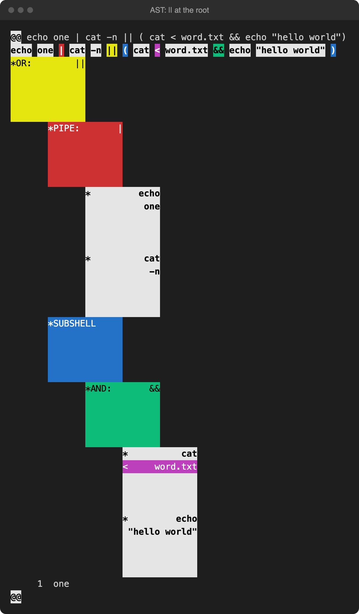
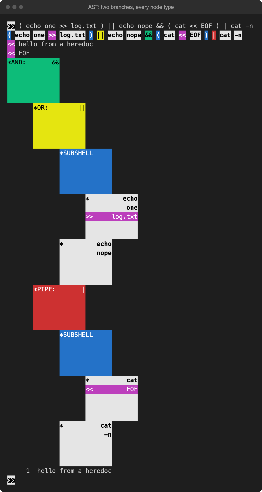
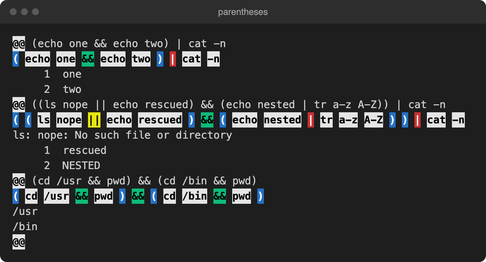
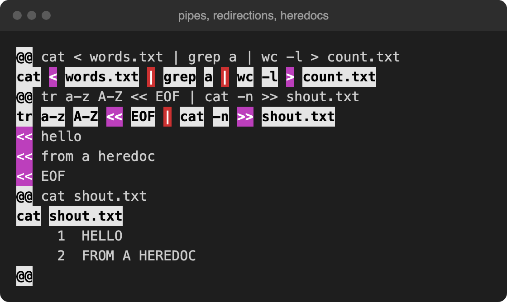
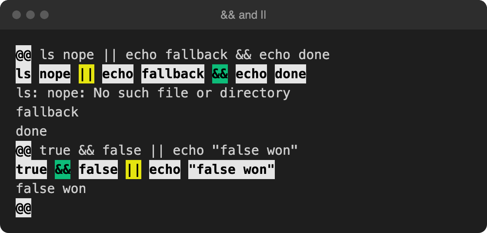
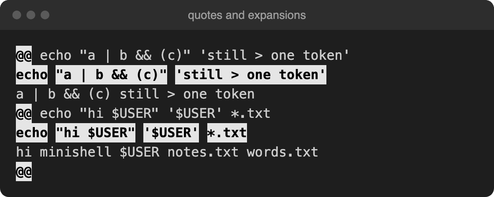
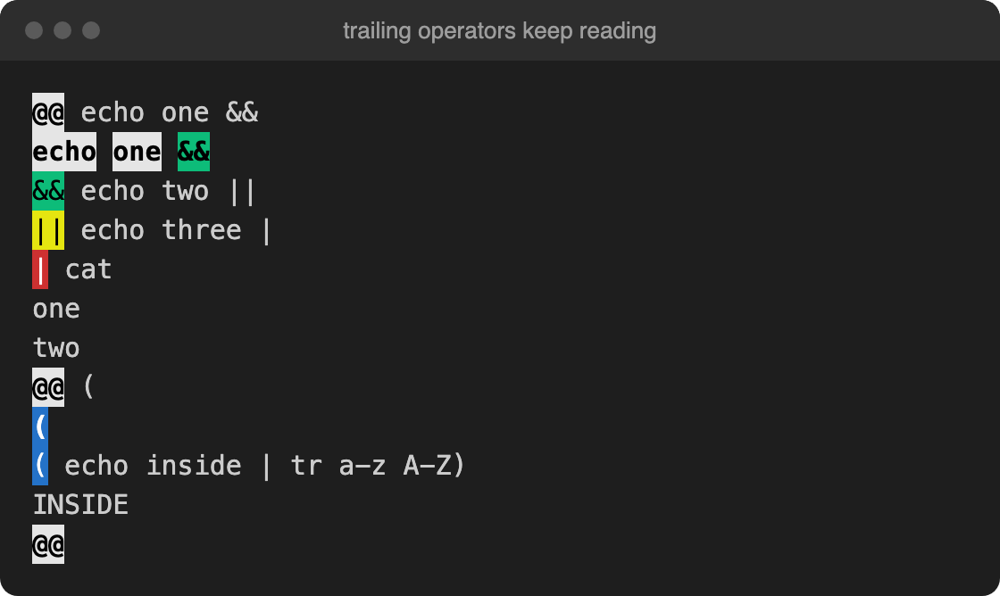
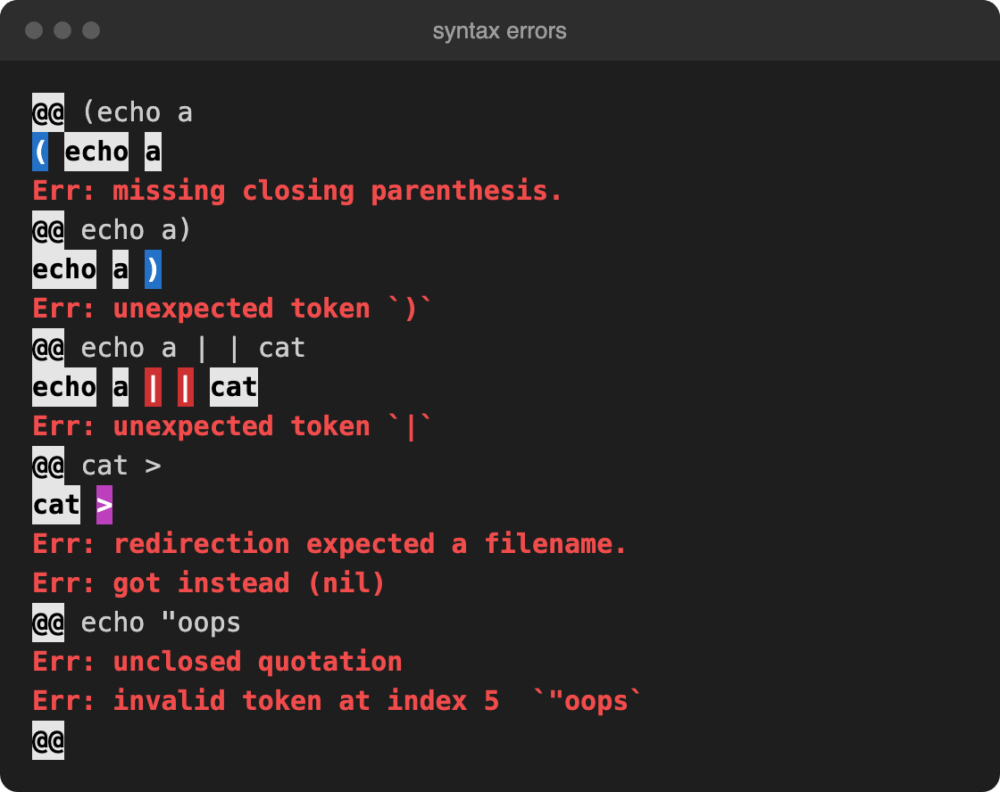

# minishell

A small shell written in C for the 42 curriculum, by wiwu and dasamuel.

I wrote a printer to vizualise the tokens and Abstract Syntax Tree the shell constructs. Which makes it easier to debug.
Note: Instead of the usual view of a tree with the root in the middle, I use indentation to indicate children (nodes that have the same indentation are siblings).

## Tokens

### Parentheses

### Pipes, redirections, heredocs

### `&&` and `||`

### Quotes and expansions

An operator inside quotes is just part of the word. `$USER` and `*.txt` are still plain words at this stage, and only get expanded when the command runs.

### Trailing operators

### Syntax errors

